# mayukh-d.github.io

My personal portfolio: a single-page, terminal-themed site built with plain HTML, CSS, and
JavaScript. No frameworks, no build step, no dependencies. One `index.html` page whose styles
and scripts are split into small component files under `assets/css/` and `assets/js/`, served
straight off GitHub Pages. How the pieces fit together, with diagrams, is in
[`docs/ARCHITECTURE.md`](docs/ARCHITECTURE.md). The one moving part is the
optional "ask me anything" terminal, backed by a small Cloudflare Worker in
[`chat-worker/`](chat-worker/).

**Live at [mayukhdas.com](https://mayukhdas.com/)**

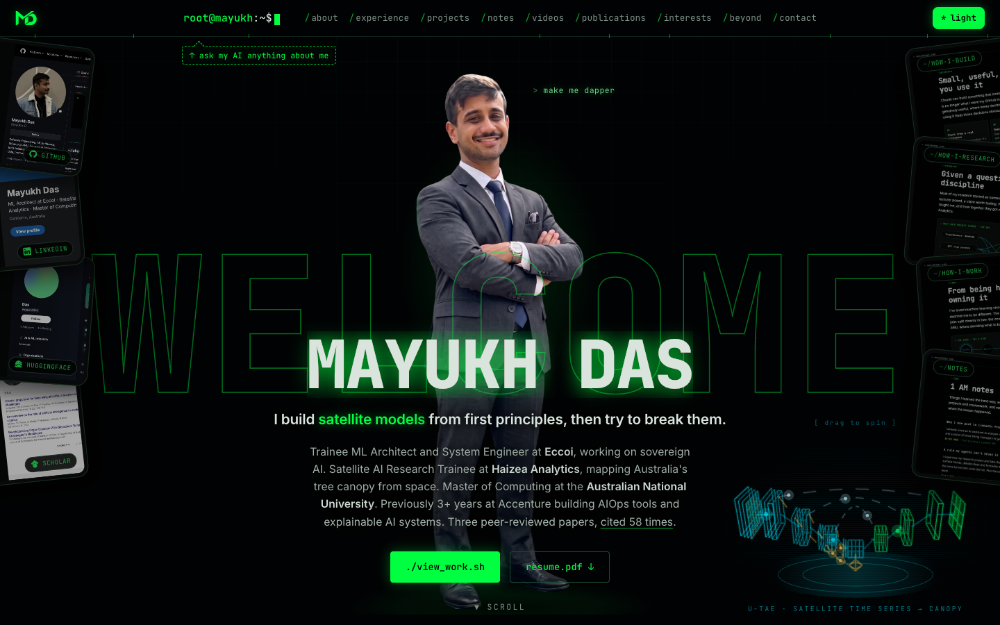

## What's in it

The page runs top to bottom as a single scroll: about, skills, experience, projects,
education, notes, videos, publications, student roles, internships, interests,
beyond_the_terminal, and contact. Two hand-rolled canvas pieces carry the visual identity,
and everything else is CSS.

Around the scroll, a few things stay put: page covers on both edges (profiles on the left,
deep dives on the right), the U-TAE hologram in the bottom-right corner, and a menu bar whose
prompt opens the ask-me-anything terminal. A deep dive swings in over the page with its own
URL, and research cards open a short tl;dr in a terminal window.

### Defence and geopolitics

A dot-matrix Dassault Rafale EH in No. 17 Squadron "Golden Arrows" markings closes the page,
drawn cell by cell on a canvas with procedurally generated cloud volumes drifting behind it.

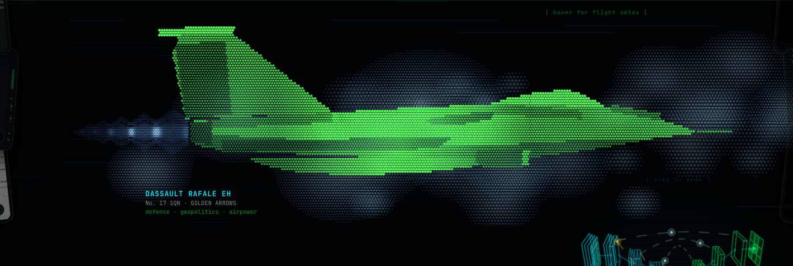

### Interests

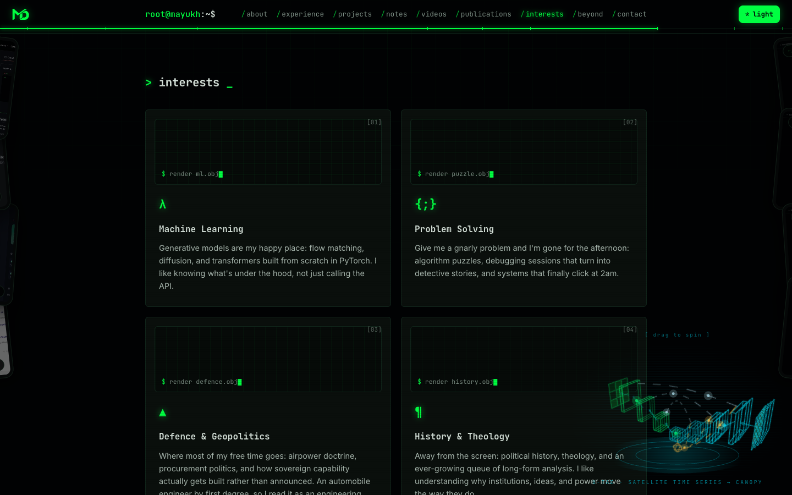

### Projects

Six projects, each linking out to its own repository, plus live demos (a Hugging Face Space
for the nanoGPT story generator, a hosted build of FoodLens) and PDF write-ups for the ML
work under `assets/reports/`.

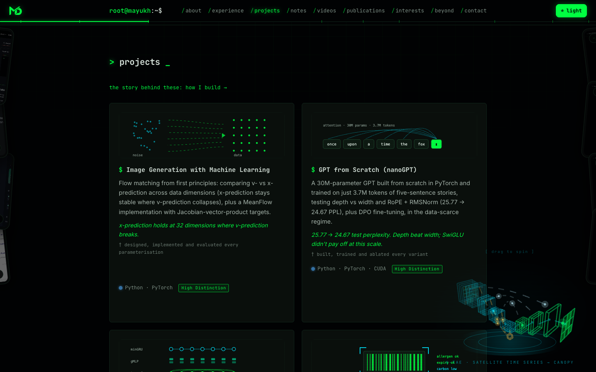

### Experience

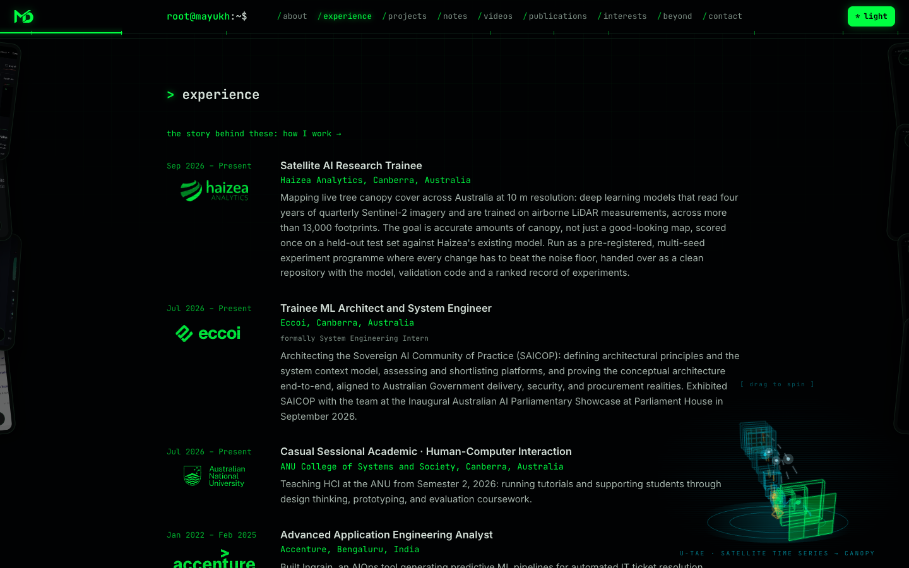

### Skills

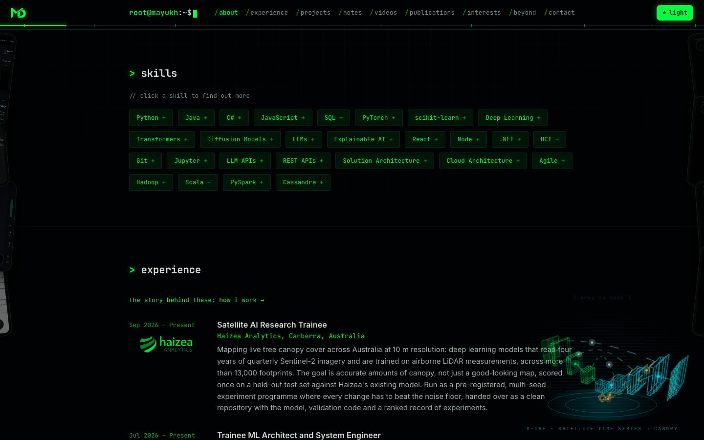

### Publications

Three papers on AI in material science, blockchain, and electric propulsion, with DOIs.

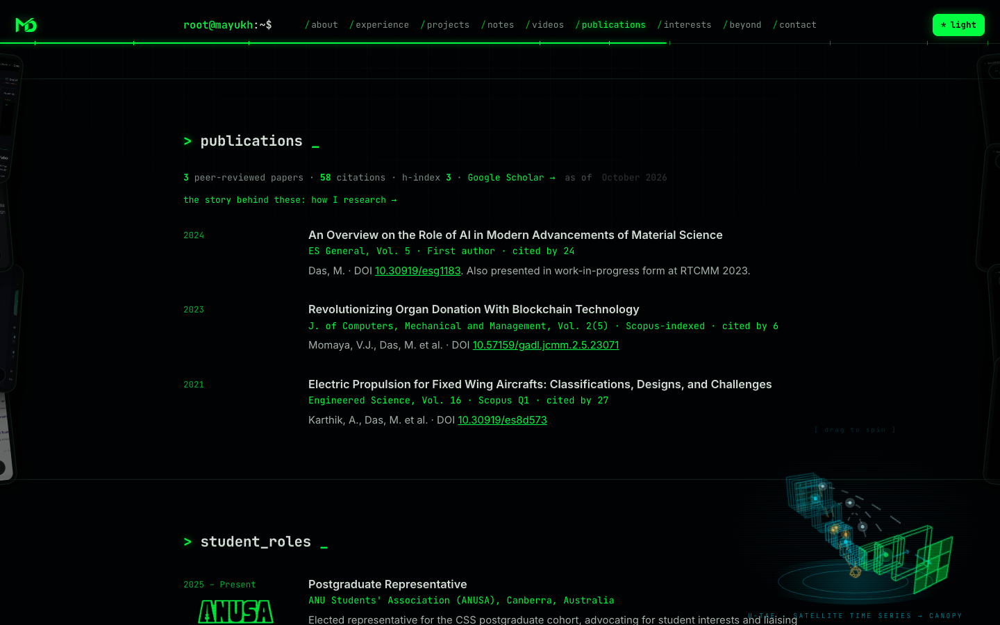

### Beyond the terminal

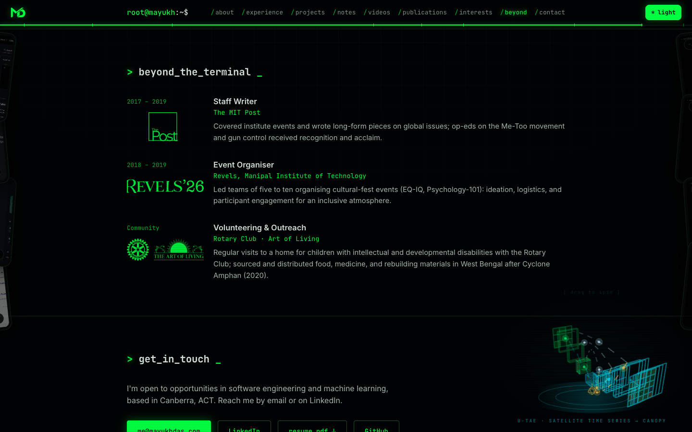

### Mobile

The layout collapses to a single column, the nav trims to a contact link, and the page
covers become slim labelled tabs on each edge that tuck away while you read. The switch is
by shape, not width: anything taller than it is wide gets the tabs.

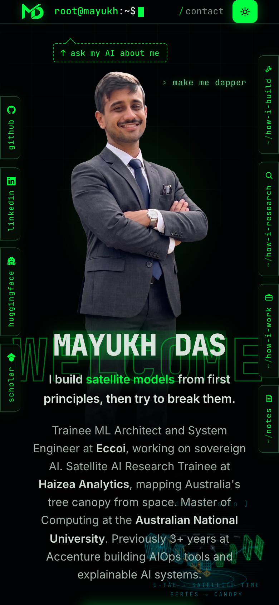

## Architecture

The page is one `index.html` for the markup, seven stylesheets and fifteen small scripts,
each a single component with a header saying what it does and what it shares. The full
write-up, with a table of every file, is in [`docs/ARCHITECTURE.md`](docs/ARCHITECTURE.md);
the three diagrams below are the short version.

### The page at a glance

Broad shapes only: what is where on a laptop and on a phone, and what opens above the page.

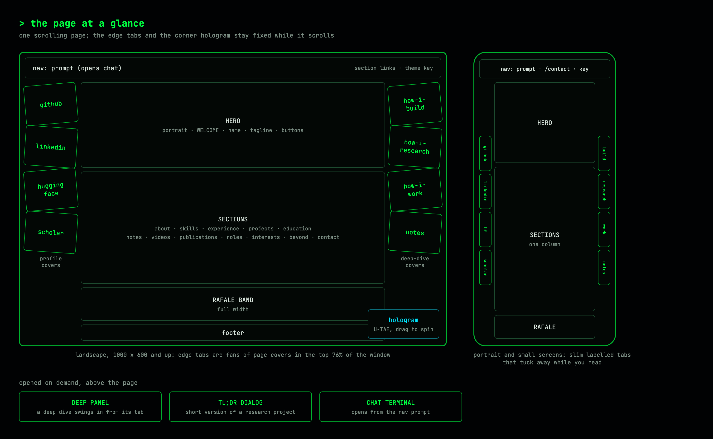

### How it loads

There is no bundler, so the order of the tags in `index.html` is the architecture. A tiny
`boot.js` runs before the first paint; the stylesheets follow in cascade order (later layers
may override earlier ones); and the scripts sit just after the markup they need.

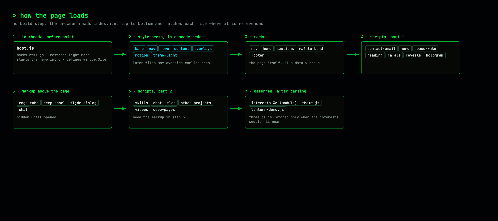

### Components and dependencies

A UML component view. Each box is one file; `+ name` is a global or function it offers to the
others, and the dashed arrows are the only places one component reaches into another. All
seven stylesheets read their colours and fonts from the tokens in `base.css`, which is also
where the terminal-window look shared by the skill notes, the tl;dr and the chat lives.

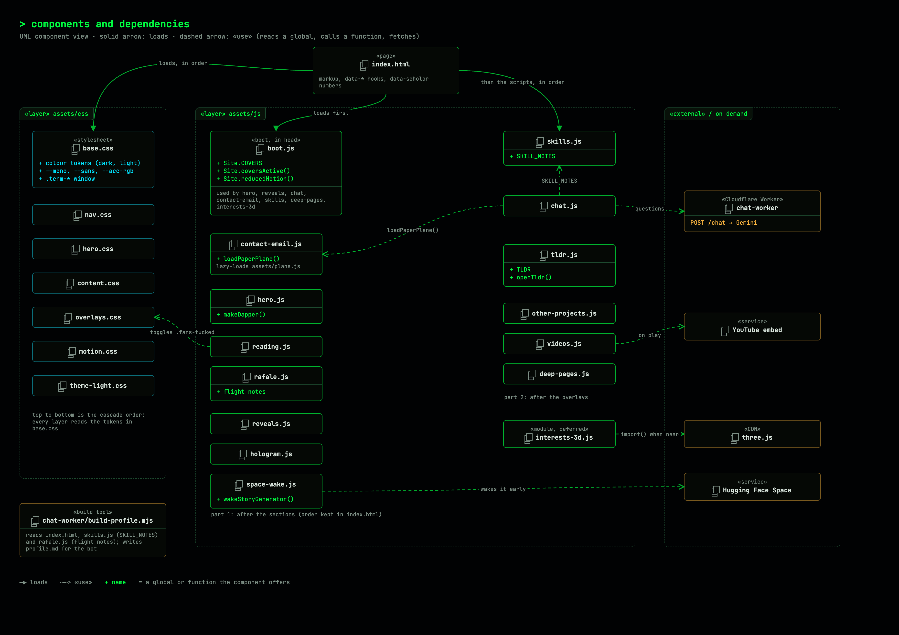

| Layer | Files | Job |
|---|---|---|
| Styles | `base`, `nav`, `hero`, `content`, `overlays`, `motion`, `theme-light` | Tokens and shared pieces, then each region of the page, then animation, then light mode |
| Boot | `boot.js` | Pre-paint setup and `window.Site`, the helpers the scripts share |
| Page | `contact-email`, `hero`, `space-wake`, `reading`, `rafale`, `reveals`, `hologram` | Everything in and around the scroll |
| Overlays | `skills`, `chat`, `tldr`, `other-projects`, `videos`, `deep-pages` | Things that open: notes, dialogs, players, deep dives |
| Module | `interests-3d` | 3D models in the interest cards, with three.js loaded only when needed |

The diagrams are drawn from HTML in [`docs/diagrams/`](docs/diagrams/); open one in a browser
and take a 2x screenshot to regenerate its image.

## Implementation notes

- **Draggable U-TAE hologram.** A wireframe of the U-TAE (a U-Net with temporal attention)
  behind my canopy mapping work: a stack of dated satellite tiles in, encoder maps with a
  ghost frame per date, a temporal attention node at the bottleneck whose masks reach every
  skip connection, and a canopy map out. Rotated with quaternions and slerped
  between orientations. Drag it to spin; flick it and it keeps its angular momentum until
  friction settles it back to a resting pose.
- **Rafale canvas.** The airframe is defined as a set of tonal polygons, sampled onto a
  hex-packed dot grid. Clouds are pre-rendered to offscreen canvases from a seeded PRNG, so
  the same sky comes back on every load.
- **Scroll reveals.** An IntersectionObserver-free sweep on scroll, with a staged entrance
  for the hero and a polling fallback for the case where fonts land late.
- **Reduced motion.** Both canvases render a single static frame and the reveals resolve
  immediately when `prefers-reduced-motion: reduce` is set.
- **Edge tabs by screen shape.** Landscape screens from 1000 x 600 get fans of real page
  screenshots, sized to fill the top 76% of the window and capped at a quarter of its width,
  so they never cover the hologram. Portrait screens get slim labelled tabs. Scrolling down
  tucks either kind to a sliver; scrolling up brings them back.
- **Light mode.** Opt-in from the menu, never from the system setting. The switch is a view
  transition, so the browser cross-fades two snapshots on the GPU instead of repainting.
- **Email.** The contact address is assembled in JavaScript at runtime rather than sitting
  in the markup, which keeps it away from the simpler scrapers.
- **Typography.** Inter and JetBrains Mono from Google Fonts, preconnected. Everything else
  is self-hosted.

## Layout

```
index.html                  the page markup; loads everything else in order
projects/ research/ jobs/   the deep dives behind the edge tabs (also real pages)
notes/ videos/ work/        1 AM notes, videos and project write-ups
assets/
  css/                      seven stylesheets by layer: base, nav, hero, content, overlays, motion, theme-light
  js/                       one script per component (boot, hero, rafale, hologram, chat, deep-pages, ...)
  deep.css, theme.js        shared with the deep-dive pages
  plane.js                  the paper plane, loaded on demand
  mayukh-full.webp          hero cut-out
  tabs/, logos/, cards/     edge-tab screenshots, organisation logos, project art
  reports/                  project write-ups linked from the projects section
  screenshots/              the page screenshots in this README
chat-worker/                the ask-me-anything backend (Cloudflare Worker)
docs/
  ARCHITECTURE.md           how the pieces fit, with a table of every file
  images/                   the architecture diagrams in this README
  diagrams/                 the HTML those diagrams are drawn from
```

## Running it locally

There is no build step. Open the file directly:

```sh
open index.html
```

Or serve it, which is closer to how GitHub Pages behaves for the root-relative favicon:

```sh
python3 -m http.server 8000
# then visit http://localhost:8000
```

## Deploying

GitHub Pages builds from the default branch. Push to it and the live site updates within a
minute or so.

## Ask-me-anything terminal

Click the blinking `root@mayukh:~$` prompt to open a terminal. Built-in commands (`help`,
`whoami`, `ls projects`, `cat pytorch`, `experience`, `contact`) answer instantly from the
page itself. Anything else goes to [`chat-worker/`](chat-worker/), a Cloudflare Worker that
asks Google Gemini to answer **only** from `chat-worker/profile.md`, which
`build-profile.mjs` generates from `index.html` (plus the skill notes and flight notes in
`assets/js/`), so the bot can't drift from what the page
says. The Gemini key lives in the Worker as a secret; visitors are rate-limited per IP and
only this site's origin is accepted.

```bash
cd chat-worker
npm install
npm test                                 # worker unit tests
npx wrangler login                       # once
npx wrangler secret put GEMINI_API_KEY   # once; paste the key at the prompt
npm run deploy                           # rebuilds profile.md, then deploys
```

After editing the site, run `npm run deploy` again so the bot learns the changes.

