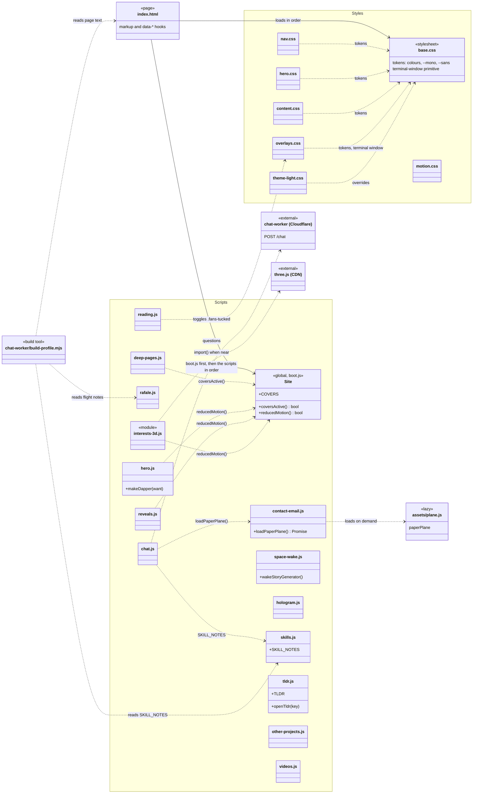

# Architecture

The site is plain HTML, CSS and JavaScript served by GitHub Pages: no framework, no bundler, no
build step. `index.html` holds the markup; its styles and behaviour live in small component files
under `assets/css/` and `assets/js/`, which the page loads in a fixed order.

## The page at a glance

Broad shapes only. On laptops and landscape tablets the edge tabs are fans of page covers; on
phones and portrait screens they are slim labelled tabs.

```
┌──────────────────────────────────────────────────────────────────────┐
│ NAV   prompt (opens chat)          section links          theme key  │
├───────┬──────────────────────────────────────────────────────┬───────┤
│       │                                                      │       │
│ LEFT  │  HERO                                                │ RIGHT │
│ EDGE  │  portrait · WELCOME · name · tagline · buttons       │ EDGE  │
│ TABS  │                                                      │ TABS  │
│       ├──────────────────────────────────────────────────────┤       │
│ prof- │  SECTIONS (one column, scrolls)                      │ deep  │
│ iles  │  about · skills · experience · projects · education  │ dives │
│       │  notes · videos · publications · roles · interests   │       │
│       │  beyond · contact                                    │       │
│       ├──────────────────────────────────────────────────────┤       │
│       │  RAFALE BAND (full width)                            │       │
│       ├──────────────────────────────────────────────────────┤ ┌─────┤
│       │  FOOTER                                              │ │HOLO-│
└───────┴──────────────────────────────────────────────────────┴─┴GRAM─┘

Above the page, opened on demand:  DEEP PANEL (a deep dive swings in) · TL;DR DIALOG · CHAT TERMINAL
```

## How the page loads

1. **`assets/js/boot.js`** runs first, in `<head>`, before anything paints: it marks `html.js`,
   restores light mode if the visitor chose it, starts the hero intro once the portrait and fonts
   are ready, and defines `window.Site`, the helpers the other scripts share.
2. **Seven stylesheets**, in cascade order. Later files may override earlier ones, so the order
   is part of the design:
   `base → nav → hero → content → overlays → motion → theme-light`.
3. **Markup** for the nav, hero and sections.
4. **Scripts, part 1** (classic, run in place): contact email, hero, Space wake-up, reading aids,
   Rafale, reveals, hologram.
5. **Markup** for the edge tabs, deep panel, tl;dr dialog and chat.
6. **Scripts, part 2** (classic, need that markup): skills, chat, tl;dr, other projects, videos,
   deep pages.
7. **`interests-3d.js`** as an ES module (deferred), and the shared `assets/theme.js` and
   `assets/lantern-demo.js`.

Classic scripts share one global scope, so the few things one component offers another are named
globals, listed in the diagram below. Everything else stays inside each file's IIFE.

## Components

### Styles (`assets/css/`)

| File | What it styles |
|---|---|
| `base.css` | Design tokens (colours for both themes, `--mono`, `--sans`, `--acc-rgb`), reset, typography, the grid and scanlines, the section shell, and the shared **terminal window** primitive used by the skill note, tl;dr and chat. |
| `nav.css` | The menu bar: prompt, links, theme key, reading-progress line, and how the nine links tighten or collapse to `/contact` as the window narrows. |
| `hero.css` | The first screen: portrait, WELCOME, name glitch, rotating and typed lines, scroll push-in, "make me dapper", and the bottom-right hologram. |
| `content.css` | The sections in page order: interests, the Rafale band, timeline, notes, videos, projects, skills, contact. |
| `overlays.css` | Everything above the page: tl;dr dialog, edge tabs (tabs or cover fans) with the deep-dive panel, and the chat terminal. |
| `motion.css` | Reveal and hero-entrance animations, off under reduced motion. |
| `theme-light.css` | Light mode ("green paper"), opt-in from the toggle only. |

`assets/deep.css` and `assets/lantern-demo.css` are shared with the standalone deep pages and stay
where they are.

### Behaviour (`assets/js/`)

| File | What it does |
|---|---|
| `boot.js` | Pre-paint setup and `window.Site` (`COVERS`, `coversActive()`, `reducedMotion()`). |
| `contact-email.js` | Builds the email address at runtime; the paper-plane send. Offers `loadPaperPlane()`. |
| `hero.js` | Rotating words, scroll push-in, typed line, "make me dapper". Offers `makeDapper()`. |
| `space-wake.js` | Pokes the sleeping nanoGPT Hugging Face Space early. Offers `wakeStoryGenerator()`. |
| `reading.js` | Reading mode (tucks the edge fans while scrolling down) and the progress line. |
| `rafale.js` | The dot-drawn Rafale and its flight-note callouts. |
| `reveals.js` | Staged hero entrance and scroll reveals. |
| `hologram.js` | The draggable U-TAE wireframe in the corner (canvas 2D, quaternion rotation). |
| `skills.js` | Skill chips and their terminal notes. Defines `SKILL_NOTES`. |
| `chat.js` | The ask-me-anything terminal: local commands, then the Cloudflare Worker. |
| `tldr.js` | Research tl;dr dialog. Defines `TLDR`, offers `openTldr()`. |
| `other-projects.js` | Project rows that grow into full cards. |
| `videos.js` | Click-to-load YouTube players. |
| `deep-pages.js` | Fetches a deep page, swings it in, gives it its own URL. |
| `interests-3d.js` | Wireframe models in the interest cards, with three.js loaded on demand. |

## UML: components and dependencies



## Conventions

- **One concern per file**, each opening with a header: what it is for, the DOM hooks it uses, and
  anything it offers or needs from another file.
- **Tokens, not raw values.** Colours and fonts come from the variables in `base.css`; the light
  theme mostly works by redefining them.
- **Asset URLs are root-relative** (`/assets/...`). A relative `url()` in a stylesheet, or in an
  inline `--var` that a stylesheet reads, resolves against `assets/css/` and 404s.
- **The cover/tab switch lives in two places:** the media queries in `overlays.css` and
  `Site.COVERS` in `boot.js`. Change both together.
- **Cache-busting:** bump the `?v=` on a file's `<link>` or `<script>` tag when you change it,
  because GitHub Pages caches assets for ten minutes.
- **The chatbot's knowledge** is generated from `index.html`, `assets/js/skills.js` and
  `assets/js/rafale.js` by `chat-worker/build-profile.mjs`; run `npm run deploy` in `chat-worker/`
  after changing what they say.
